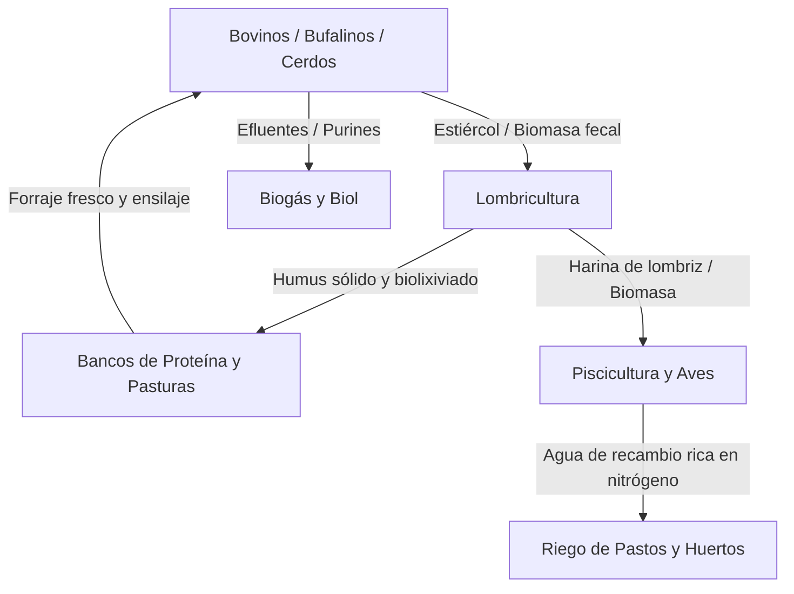

# 🚀 PLAN MAESTRO DE MODERNIZACIÓN Y ACTUALIZACIÓN TOTAL: AGROSUITE 360°

---

## 🧭 Visión Estratégica

Transformar el actual panel de 32 calculadoras estáticas en una **plataforma integral de gestión, simulación predictiva y toma de decisiones agropecuarias de alto nivel (AgroSuite 360°)**, manteniendo su mayor fortaleza: **cero costes de servidor, 100% privada, offline y ultrarrápida**.

---

## 🏛️ Eje 1: Arquitectura y Ecosistema de Datos

### 1.1 Progressive Web App (PWA) de Alto Rendimiento
* **Objetivo:** Convertir la suite en una aplicación instalable en teléfonos móviles (Android/iOS), tablets y computadoras portátiles para uso en campo sin conectividad.
* **Componentes:**
  * `manifest.webmanifest`: Iconos vectoriales, colores temáticos, modo pantalla completa.
  * `sw.js` (Service Worker): Cacheado estratégico de assets estáticos y librerías CDN para que funcione en cualquier potrero sin cobertura celular.

### 1.2 Sistema de Gestión Multi-Predio ("Mis Fincas")
* Permitir crear múltiples unidades de producción:
  * *Ejemplo:* "Finca Santa Inés (Zulia)", "Hato El Recuerdo (Llanos)".
  * Selector global en el Hub que cambia el contexto de datos de todas las calculadoras simultáneamente.
* **Bóveda de Respaldo:**
  * Exportación total en un clic: archivo `.agrobackup` (JSON comprimido/cifrado opcional).
  * Importación con validación de esquema e historial de versiones.

---

## 🔬 Eje 2: Inteligencia Zootécnica y Modelado Avanzado

### 2.1 Simulador de Resiliencia Climática y Sensibilidad (Stress Testing)
* Control maestro en el Hub: **"Modo Escenario"** (Pesimista / Esperado / Favorable).
* **Variables estacionales críticas:**
  * Déficit hídrico (sequía de 3, 5 o 7 meses): reduce automáticamente la oferta de forraje en un 25%–60%.
  * Desviación de precios: fluctuación del precio del kilo de carne o queso (+/- 20%).
  * Alza de materias primas: incremento en el saco de concentrado o maíz.
* Resultado instantáneo: cálculo de cuántas cabezas deberían descargarse preventivamente o cuánta suplementación de emergencia se requiere antes de que ocurra la pérdida de peso corporal.

### 2.2 Motor de Diagnóstico Zootécnico Automático ("Semáforo Experto")
En cada calculadora, un panel de auditoría heurística detecta inconsistencias biológicas en tiempo real:
* ⚠️ *Alerta:* Si la tasa de preñez es $< 70\%$ con relación vaca:toro $< 20$, alertar sobre posible subfertilidad o problemas nutricionales.
* ⚠️ *Alerta:* Si la carga supera $2.5\text{ UA/ha}$ en pastos naturales de sabana, marcar sobrepastoreo inminente y degradación de praderas.
* 💡 *Sugerencia técnica:* Recomendar bancos forrajeros proteicos (Matarratón, Leucaena, Botón de Oro) cuando el balance forrajero esté en déficit.

---

## 🔄 Eje 3: Módulo de Sinergias y Economía Circular ("Granja Integrada")

Actualmente los 32 módulos operan como islas. La mayor innovación consiste en una **calculadora de ciclo cerrado**:

* **Cálculo de Biomasa Residual:** Cálculo automático de heces producidas al día según los animales del predio.
* **Ahorro en Fertilizantes Químicos:** Estimación del valor monetario ahorrado al fertilizar potreros con humus propio.

---

## 📈 Eje 4: Experiencia Visual, Gráficos y Reportes Ejecutivos

### 4.1 Visualización Interactiva (Librería Canvas/SVG Ultra-ligera)
Incorporar gráficos dinámicos sin penalizar la velocidad de carga (Chart.js modular o SVG nativo):
1. **Curva de Población a 10 Años:** Evolución de vientres, crías y animales en ceba.
2. **Pirámide Etaria del Hato:** Distribución porcentual entre crías, levante y reproductores.
3. **Gauge de Seguridad Forrajera:** Tacómetro visual del balance forrajero (Verde: Superávit; Amarillo: Precaución; Rojo: Déficit crítico).
4. **Estructura de Costes (Donut Chart):** Desglose entre alimentación, sanidad y mantenimiento.

### 4.2 Generador de Informes Técnicos para Banca e Inversores (PDF Pro)
* Impresión técnica estandarizada:
  * Portada con datos de la finca, fecha y versión del plan.
  * Resumen ejecutivo en una página con métricas financieras (Ingresos proyectados, inversión en infraestructura y punto de equilibrio).
  * Fichas de requerimientos de potreros y plano de corrales estimado.
  * Formato listo para solicitudes de crédito agropecuario o auditorías técnicas.

---

## 💰 Eje 5: Capa de Análisis Financiero y Flujo de Caja

Agregar a cada módulo una sección de **Evaluación Financiera Básica**:
* **Flujo de Caja Anual Proyectado (Año 1 a Año 10):**
  * Ingresos por venta de carne, animales de descarte, leche, queso, huevos o miel.
  * Costos operativos (alimentación, plan sanitario, salarios estimados).
* **Métricas de Viabilidad:**
  * Margen bruto anual por animal y por hectárea.
  * Punto de equilibrio (kg de carne o litros de leche necesarios para cubrir costos fijos).

---

## 🛠️ Plan de Implementación por Fases

| Fase | Enfoque Principal | Entregables Clave |
| :--- | :--- | :--- |
| **Fase 1: Motor Gráfico & PWA** | Visualización y Portabilidad | • Gráficos interactivos en rumiantes y porcinos. • Service Worker + manifiesto offline PWA. • Modo oscuro/claro perfeccionado. |
| **Fase 2: Alertas y Diagnóstico Zootécnico** | Asesoría inteligente | • Sistema de semáforos y reglas heurísticas veterinarias. • Tarjetas de recomendaciones de manejo agronómico. |
| **Fase 3: Multi-Finca & Finanzas** | Gestión integral | • Selector multi-predio en el Hub. • Bóveda de respaldo / exportación JSON. • Flujo de caja y márgenes por hectárea. |
| **Fase 4: Economía Circular** | Sinergias productivas | • Nuevo módulo "Granja Integrada y Economía Circular". • Generador de reportes ejecutivos en PDF. |
